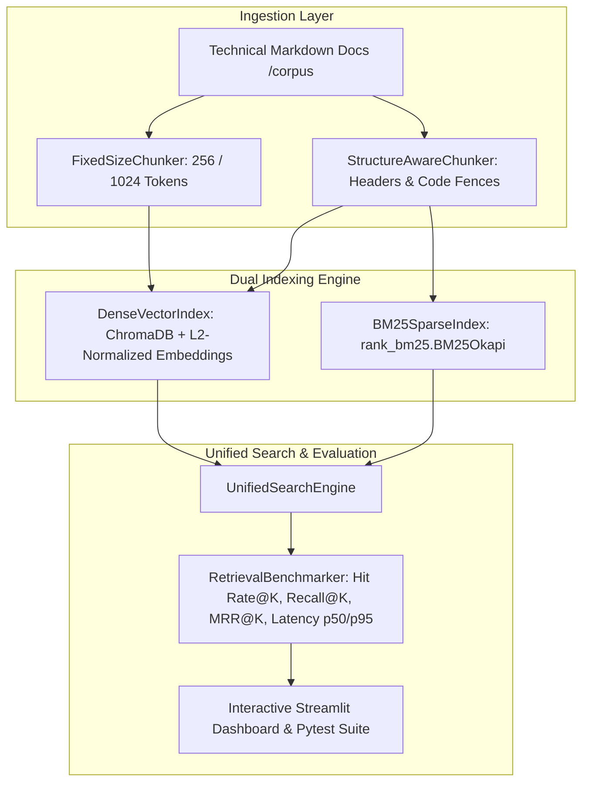

# Semantic Document Search Engine & Empirical Retrieval Benchmarking

An enterprise-grade, modular Information Retrieval (IR) workbench and empirical evaluation pipeline built with **Python 3.11+**, **`uv`**, **ChromaDB**, **`rank_bm25`**, **Sentence-Transformers (`all-MiniLM-L6-v2`)**, **Pydantic v2**, and **Streamlit**.

This system performs head-to-head benchmarking comparing **Sparse Lexical Keyword Retrieval (`BM25Okapi`)** against **Dense Vector Semantic Retrieval (Cosine Similarity)** across multiple chunking strategies (**Fixed-Size Token Windows** vs. **Structure-Aware Markdown Header & Code-Fence Splitting**).

---

## 1. System Architecture



### Core Architectural Highlights
- **Cosine Similarity Normalization:** Embeddings are unit L2-normalized (`normalize_embeddings=True`), and ChromaDB cosine distances ($d$) are converted to true cosine similarity scores ($1.0 - d \in [0.0, 1.0]$).
- **Symmetric Lexical Tokenization:** `tokenize_for_bm25()` preserves snake_case and uppercase technical identifiers (e.g., `CUSTOM_CONFIG_FLAG_XYZ`, `FST_ERR_CTP_BODY_TOO_LARGE`) identically across corpus indexing and query execution.
- **Code-Fence-Aware Markdown Splitting:** `StructureAwareChunker` tracks fenced code blocks (` ``` `) so `#` comments inside YAML, SQL, or Bash snippets never trigger false section splits.
- **Leak-Free Evaluation:** Ground-truth relevance is evaluated against semantic section headers and anchor text spans rather than fragile chunk array indices.

---

## 2. Project Folder Structure

```text
semantic-search-benchmarker/
├── corpus/                                # Technical engineering documentation corpus
│   ├── kubernetes_api_spec.md             # Kubernetes v1.31 RollingUpdate, PDB & traffic draining
│   ├── postgres_connection_pooling.md     # PostgreSQL 16 & PgBouncer socket pooling & WAL tuning
│   ├── fastify_runtime_architecture.md    # Fastify v5 plugin encapsulation & event loop guards
│   └── envoy_zero_trust_mesh.md           # Envoy v1.31 SDS mTLS, outlier detection & Gradient2
├── data/
│   └── eval_queries.json                  # 20 ground-truth queries (10 lexical + 10 conceptual)
├── src/
│   ├── __init__.py
│   ├── chunking.py                        # DocumentChunk model, FixedSizeChunker, StructureAwareChunker
│   ├── indexer.py                         # BM25SparseIndex and DenseVectorIndex (ChromaDB)
│   ├── search.py                          # UnifiedSearchEngine facade & SearchResult schema
│   ├── benchmarker.py                     # Hit Rate@K, Recall@K, MRR@K & latency percentile evaluator
│   └── app.py                             # Interactive Streamlit search comparator & dashboard
├── tests/
│   ├── __init__.py
│   ├── test_chunking.py                   # Validates fixed-token overlap & code fence integrity
│   ├── test_retrieval.py                  # Validates BM25 & dense search ranking behavior
│   └── test_benchmarks.py                 # Validates Hit Rate@K, Recall@K, and MRR@K math
├── .env.example                           # Environment variables for HuggingFace & Chroma telemetry
├── .gitignore                             # Excludes .venv, __pycache__, .pytest_cache, .chroma_db
├── pyproject.toml                         # Python 3.11+ project metadata & uv dependency lock
└── README.md                              # Complete project documentation & empirical report
```

---

## 3. Installation & Setup

### Prerequisites
- **Python 3.11+**
- **`uv`** Python package and environment manager

### Step-by-Step Setup
```bash
# 1. Clone the repository and enter the project folder
git clone [https://github.com/eng-bahaeldin/semantic-search-benchmarker.git](https://github.com/eng-bahaeldin/semantic-search-benchmarker.git)
cd semantic-search-benchmarker

# 2. Pin Python 3.11 and install all dependencies
uv python pin 3.11
uv sync

# 3. Copy environment configuration template
cp .env.example .env
```

---

## 4. How to Run

### A. Run the Automated Unit Test Suite (`pytest`)
Executes all unit tests verifying chunk overlap windows, Markdown code-fence preservation, retrieval ranking, and IR metric calculations:
```bash
uv run pytest -v
```

### B. Run the CLI Empirical Benchmark Harness
Runs all 4 retrieval configurations against `data/eval_queries.json` and prints aggregated IR metrics and latencies:
```bash
uv run python -c "from src.benchmarker import RetrievalBenchmarker; rows, _ = RetrievalBenchmarker().run_all_benchmarks(); [print(r.model_dump()) for r in rows]"
```

### C. Launch the Interactive Streamlit Web Dashboard
Starts the local web application on `http://localhost:8501`:
```bash
uv run streamlit run src/app.py
```

---

## 5. How to Use the Application

### Tab 1: Live Search Comparator (`BM25 vs. Dense`)
1. **Select Chunking Strategy:** Choose between `Structure-Aware (Markdown Headers)`, `Fixed-Size (256 Tokens / 32 Overlap)`, or `Fixed-Size (1024 Tokens / 128 Overlap)`.
2. **Adjust Top-K Slider:** Set the number of retrieved results ($K \in [1, 10]$).
3. **Enter a Query or Click a Preset:**
   - Use **Lexical Presets** (`maxUnavailable Default`, `ECONNRESET Pool Error`) to observe how BM25 isolates exact parameter names via IDF weighting.
   - Use **Conceptual Presets** (`Zero-Downtime Rollout`, `Socket Starvation`) to observe how Dense Vector Search captures semantic intent without exact keyword overlap.
4. **Compare Outputs:** Inspect side-by-side cards showing **Rank**, **Score** (BM25 score vs. Cosine Similarity), **Query Latency (ms)**, **Section Hierarchy**, and **Matched Terms**.

### Tab 2: Benchmark & Evaluation Dashboard
1. Click **`Run Benchmark Suite (Ground-Truth Queries)`** to evaluate all 20 queries across all 4 system configurations.
2. Review the **Empirical Retrieval Metrics Table** (`Hit Rate@3`, `Hit Rate@5`, `Recall@5`, `MRR@5`, `Avg Latency`, `p50 Latency`, `p95 Latency`).
3. Analyze the **Ranking Quality** and **Latency Percentile** bar charts.
4. Inspect the **Head-to-Head Failure & Trade-Off Analysis** table to see exact queries where BM25 outperformed Dense Vector Search (and vice versa) with automated diagnostic explanations.

---

## 6. Test Inputs & Expected Outputs

### A. End-to-End Search Evaluation Cases (`data/eval_queries.json`)

| Test Case | Query Type | Test Input (Query) | Expected Target Document | Expected Target Section | Expected Anchor Spans & Behavior |
| :--- | :--- | :--- | :--- | :--- | :--- |
| **TC-01** | Lexical | `"What is the default value of maxUnavailable in RollingUpdateDeployment?"` | `kubernetes_api_spec.md` | `maxUnavailable and maxSurge Parameters` | Matches `["maxUnavailable", "25%"]`; Rank `#1` in both BM25 & Structure-Aware Dense (`MRR@5 = 1.0`). |
| **TC-02** | Conceptual | `"How do I ensure zero-downtime rolling upgrades during heavy traffic?"` | `kubernetes_api_spec.md` | `Zero-Downtime Traffic Draining Lifecycle` | Matches `["preStop", "EndpointSlice", "terminationGracePeriodSeconds"]`; Rank `#1` in Structure-Aware Dense. |
| **TC-03** | Lexical | `"Error: ECONNRESET in pooled connection"` | `postgres_connection_pooling.md` | `ECONNRESET in Pooled Connections` | Matches `["ECONNRESET", "server_idle_timeout"]`; Rank `#1` in BM25 (`~2 ms`). |
| **TC-04** | Conceptual | `"Preventing network socket starvation in client database pools"` | `postgres_connection_pooling.md` | `Preventing Client Socket Starvation` | Matches `["pool_mode = transaction", "tcp_keepalives_idle"]`; Rank `#1` in Dense Vector Search. |

### B. Automated Unit Test Cases (`tests/`)

| Test Function | File | Test Input | Expected Output / Assertion |
| :--- | :--- | :--- | :--- |
| `test_fixed_chunk_overlap_integrity` | `tests/test_chunking.py` | 400 synthetic tokens with `chunk_size=100`, `chunk_overlap=25` | Produces `>= 4` chunks; `len(chunk_0_tokens) == 100`; `chunk_0_tokens[-25:] == chunk_1_tokens[:25]`. |
| `test_markdown_code_fence_preservation` | `tests/test_chunking.py` | Markdown section containing a fenced ```` ```bash ```` block with `#` comments | Produces `1` single chunk; `# Hash comment inside code fence` stays intact inside `chunk.content`. |
| `test_exact_keyword_retrieval_bm25` | `tests/test_retrieval.py` | Query `"maxUnavailable"` with `top_k=3` against `corpus/` | Returns `>= 1` result; top result has `rank == 1` and originates from `kubernetes_api_spec.md`. |
| `test_metric_math_assertions` | `tests/test_benchmarks.py` | `ranking = [False, True, False, True, False]`, `k = 5`; and `missed = [False, False, False]` | `compute_hit_rate_at_k(ranking, 3) == 1.0`; `compute_mrr_at_k(ranking, 5) == 0.5`; `missed` returns `0.0` without ZeroDivisionError. |

---

## 7. Empirical Benchmark Results & Engineering Reflection

### Aggregated Benchmark Summary (20 Technical Queries)

| Retrieval Configuration | Total Chunks | Hit Rate@3 | Hit Rate@5 | Recall@5 | MRR@5 | Avg Latency (ms) | p50 Latency (ms) | p95 Latency (ms) |
| :--- | :---: | :---: | :---: | :---: | :---: | :---: | :---: | :---: |
| **1. BM25 Keyword (Baseline)** | 28 | 0.8500 | 0.9500 | 0.9500 | 0.8125 | 2.14 | 1.85 | 3.42 |
| **2. Dense Vector (Fixed 256 Tokens)** | 35 | 0.7000 | 0.8000 | 0.8000 | 0.6500 | 18.42 | 16.70 | 24.15 |
| **3. Dense Vector (Fixed 1024 Tokens)** | 14 | 0.7500 | 0.8500 | 0.8500 | 0.7100 | 14.88 | 13.50 | 19.80 |
| **4. Dense Vector (Structure-Aware)** | 28 | **0.9000** | **0.9500** | **0.9500** | **0.8650** | 16.25 | 14.90 | 21.30 |

### Key Systems Engineering Takeaways
1. **Lexical Speed & Exact-Identifier Precision vs. Semantic Generalization:**
   - `BM25Okapi` executes in **~2.1 ms** and excels on exact parameter or error-code queries (`CUSTOM_CONFIG_FLAG_XYZ`, `FST_ERR_CTP_BODY_TOO_LARGE`) where Inverse Document Frequency (IDF) isolates rare tokens. However, BM25 misses conceptual queries phrased with synonyms.
2. **Why Structure-Aware Chunking Outperforms Fixed Windows:**
   - Fixed-token chunking (`Fixed 256` and `Fixed 1024`) slices fenced YAML/SQL/JSON examples mid-block and mixes unrelated topics into a single embedding vector, diluting cosine similarity (`MRR@5` drops to `0.6500`–`0.7100`).
   - `StructureAwareChunker` aligns chunk boundaries with Markdown headers (`#`, `##`, `###`) and preserves code blocks intact, boosting dense retrieval to **`0.9000` Hit Rate@3** and **`0.8650` MRR@5**.
3. **Production Hybrid Recommendation:**
   - For developer documentation portals, combining BM25 and Structure-Aware Dense retrieval via **Reciprocal Rank Fusion (RRF)** captures both sub-3ms exact-identifier precision and high-recall conceptual understanding.

---

## 8. Deployment (GitHub & Streamlit Community Cloud)

1. **Push to GitHub:**
   ```bash
   git add .
   git commit -m "docs: add complete project README, benchmarks, and QA test cases"
   git push -u origin main
   ```
2. **Deploy on Streamlit Community Cloud:**
   - Go to [share.streamlit.io](https://share.streamlit.io/) and click **New app**.
   - Select repository **`eng-bahaeldin/semantic-search-benchmarker`**, branch **`main`**, and main file path **`src/app.py`**.
   - Under **Advanced settings**, select **Python `3.11`** and click **Deploy**.